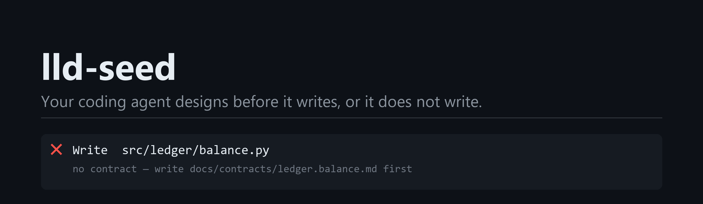
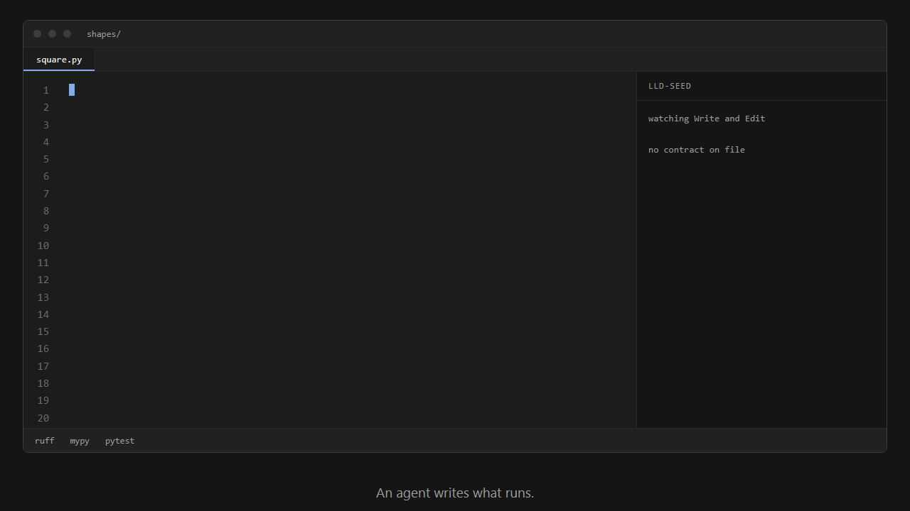
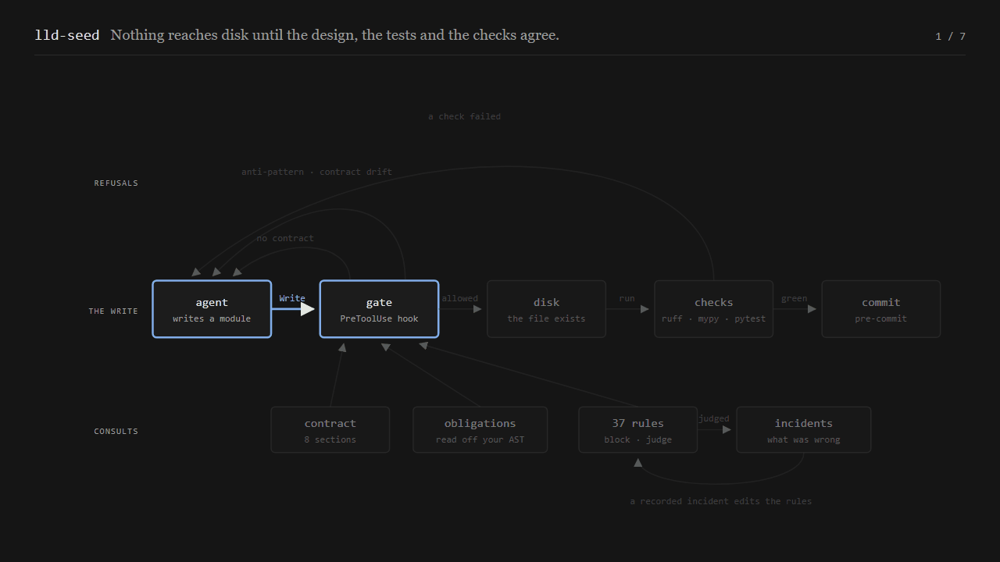

<p align="center">
  <picture>
    <source media="(prefers-color-scheme: dark)" srcset="docs/assets/banner-dark.png">
    <source media="(prefers-color-scheme: light)" srcset="docs/assets/banner-light.png">
    
  </picture>
</p>

<p align="center">
  
  
  
  
  
</p>

<p align="center">
  <picture>
    <source media="(prefers-color-scheme: dark)" srcset="docs/assets/demo.gif">
    <source media="(prefers-color-scheme: light)" srcset="docs/assets/demo-light.gif">
    
  </picture>
</p>

## Install

```
/plugin marketplace add dt1729/claude_lld
/plugin install lld-seed@dt1729
```

Then, in the Python repo you want governed:

```
/lld-seed:scaffold-guidance
```

> **It will refuse writes.** A `PreToolUse` hook blocks new modules under `src/` that have no
> design contract. That is the feature. `LLD_GATE=off` disables it; `.lld/gate.log` records
> every decision it makes.

## Why

Coding agents default to code that exists and runs: no low-level design, no seams between
independent logic, no compartmentalisation. Flat functions, shallow tests and tangled imports
follow from that. This plugin supplies the missing step and refuses to let it be skipped.

## How it works

<p align="center">
  <picture>
    <source media="(prefers-color-scheme: dark)" srcset="docs/assets/flow.gif">
    <source media="(prefers-color-scheme: light)" srcset="docs/assets/flow-light.gif">
    
  </picture>
</p>

| Layer | Mechanism |
| --- | --- |
| Vocabulary | `GLOSSARY.md` — module, interface, depth, seam, adapter |
| Design | `codebase-design` skill — deep modules, the deletion test, design it twice |
| Conventions | `python-style` skill — four reference files of judgment-only rules |
| Observability | `logging` skill — levels by who must act, library-versus-application split |
| Tests | `test-design` skill + 9 AST-checked test rules — a test must be able to fail |
| Test generation | `/lld-seed:scaffold-tests` — obligations read off the source AST, as failing stubs and a sandbox |
| Contract drift | Rule 37 — the module is checked against the interface its contract promises |
| Gate | `PreToolUse` hook — no implementation in `src/` without a contract |
| Enforcement | ruff, mypy `--strict`, import-linter, pytest, pre-commit |
| Per-folder guidance | `/lld-seed:scaffold-guidance` — recursive, idempotent `CLAUDE.md` |

Anything a tool can check is enforced by the tool and named, not restated, in the prose.
See `SCOPE.md` for the division of labour.

## Status

v0.1.0. Built and validated against real code.

- 221 tests, `ruff` + `mypy --strict` + `pre-commit` green, plugin validates.
- Calibrated against a repository it did not write (`docs/incidents.md`, incident 001).
- One module built end to end through the flow, then reviewed against every rule:
  `docs/phase-4-review.md`. It passes every gate and has six semantic defects, which is the
  honest measure of what this does and does not buy.

**Unverified:** the `PreToolUse` hook has been exercised with real payloads through the
exact command string the manifest declares, but never observed intercepting a write inside a
live session — a plugin installed mid-session does not activate its hooks until restart.

## Credits

The deep-module vocabulary, the design-it-twice procedure and the entry-point boundary rule
are adapted from [mattpocock/skills](https://github.com/mattpocock/skills), which applies
them to TypeScript. Divergences are recorded in `GLOSSARY.md`.

The demo pipeline — author each frame as HTML, screenshot it with headless Chrome, assemble
with Pillow, transcode with ffmpeg — is taken from
[Parth1811/JevFlow](https://github.com/Parth1811/JevFlow). Keeping the design in CSS rather
than in drawing coordinates is their idea, and it is a better one than the approach it
replaced here.

MIT licensed.
